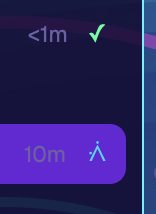
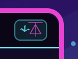

# Glyph badges for Herdr

Animated status badges for [Herdr](https://herdr.dev): working agents cycle through runes and symbols, idle ones breathe a pause mark, done shows a check, and blocked pulses an alert. They appear in the tab bar, the agents list and the pane header. Colors come from your active theme.

## Install

Ask Herdr's agent in your window to add it from this repo's link. Herdr's own flow copies the mod folders in without overwriting anything, then runs `herdr-app check` on each.

By hand:

1. Copy `mods/glyph-agents`, `mods/glyph-tabs` and `mods/glyph-pane` into `~/.config/herdr-app/mods/`.
2. Make a layout of your own: `layout.clone` your current one, or copy a shipped layout to a new name. Do not edit `main.json` in place, because Herdr restores it on upgrade.
3. In that layout, point the `agents`, `tabs` and `pane` blocks at `glyph-agents`, `glyph-tabs` and `glyph-pane`.
4. `herdr-app do layout.switch --name <your layout>`. To go back, switch to your old layout and delete the three folders.

Check each mod with `herdr-app check ~/.config/herdr-app/mods/<name>`.

## Colors

`status.js` reads the theme it is handed: `working`, `blocked`, `done`, `idle`, `dim`, `accent` and `accent_foreground`. Nothing is hardcoded except fallbacks for a theme that lacks a name.

## Notes

- Built and checked on Herdr 0.1.16. If your shipped mods differ, `RECIPE.md` lists the four small edits to re-apply to your own copies.
- If your layout pins its own `theme`, `app.theme` won't change colors. Change the theme in the layout.
- Checked on `neon-city` and `atom-one-dark`. Light themes are untested.
- The mods are modified copies of Herdr's shipped `agents`, `tabs` and `pane` mods, under Apache-2.0 (`LICENSE`).
- No network calls, no programs run, no files read outside each mod's folder.
