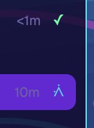

# Glyph badges

Replaces Herdr's status indicators (the tab bar, the agents list and the pane header) with animated glyph badges. A working agent shows two small cells cycling through runes and technical symbols. Blocked pulses an alert, done shows a check, idle breathes a pause mark. Every color comes from the active theme, so it follows whichever theme you run.

## What you see

- **Working:** a rounded pill holding two glyph cells. The left cell cycles through runes (Runic, Ogham, Canadian syllabics) in the theme's `working` color. The right cell cycles through technical symbols, operators, shapes and alchemical signs in the theme's `accent` color. The pill has a faint `working` fill and border. In the agents list's narrow (rail) mode it is a single cell with no pill.
- **Idle:** two small pause bars (`❚❚`) in the theme's `idle` color (falling back to `dim`) that slowly fade in and out.
- **Done:** a `✓` in the theme's `done` color. In the agents list's full mode it is a pill reading `✓ DONE`.
- **Blocked:** a pulsing alert in the `blocked` color. Compact sizes show a `!` square. The full agents-list size shows a `▲ NEEDS YOU` pill whose text uses the theme's `accent_foreground`.
- Unknown or missing status: a small dim dot.

## How it behaves

Every agent status is drawn by one function, `glyphStatus(t, status, { size, key })`, in `status.js`. `size` is `"full"`, `"mini"` or `"rail"`. `key` seeds each badge's own glyph sequence and speed (about ±15%), so no two badges look alike. Nothing is clickable. All animation is native (`frames`, `loop`), with no timers.

## Built from

- `mods/glyph-agents`, `mods/glyph-tabs` and `mods/glyph-pane` are copies of Herdr's shipped `agents`, `tabs` and `pane` mods (Herdr 0.1.16). Each changes only where it draws status.
- Each of the three folders holds the same `status.js`, because a mod imports from its own folder (`./status.js`).
- `status.js` imports `div` from `gpui-kit` and `h_flex` from `gpui-base`. It reads only the theme object it is handed. It makes no network calls, runs no programs and reads no files.
- The wiring edits, if you rebuild against a different Herdr version:
  1. In each of the three `main.js` files, add `import { glyphStatus } from "./status.js";` after the `herdr` import.
  2. **agents:** at the top of the `status(t, a, compact = false)` method add `return glyphStatus(t, a.status, { size: compact ? "rail" : "full", key: a.address ?? a.pane ?? a.id ?? "" });`
  3. **tabs:** replace the two `.when(c.status === ...)` children (the spinner for `working`, and the dot for `blocked` or `done`) with `.when(Boolean(c.status), el => el.child(glyphStatus(t, c.status, { size: "mini", key: c.id })))`
  4. **pane:** replace the three `.when(st === ...)` children (spinner, "Needs you", dot) with `.when(Boolean(st), el => el.child(glyphStatus(t, st, { key: pane })))`
- A layout that uses the mods. Copy your layout to a new name with `layout.clone` and set its `agents`, `tabs` and `pane` blocks to `glyph-agents`, `glyph-tabs` and `glyph-pane`. Then `layout.switch {name}`.

## Watch out

- Herdr has no hook for replacing the badge. Each mod draws its own, so the mods have to be swapped. A layout that doesn't use `agents`, `tabs` and `pane` shows no glyph badges until its blocks point at these mods.
- Do not edit `layouts/main.json` in place. Herdr restores its shipped version on upgrade. Use a layout with its own name.
- If your version of the shipped mods differs from 0.1.16, re-apply the four edits above to your own copies (`mod.clone`) instead of copying these files.
- Contrast on very light themes is untested. Only the idle and working states were checked on a second theme (`atom-one-dark`). Blocked and done were checked only on `neon-city`.
- Glyph availability depends on the terminal UI font. A missing glyph shows a blank frame for that tick.
- The mods are modified copies of Herdr code under Apache-2.0 (see `LICENSE`).

## Done when

- `herdr-app check` passes on each of `glyph-agents`, `glyph-tabs` and `glyph-pane`.
- After `layout.switch` to a layout that uses them, the agents list, the tab bar and the pane header show glyph badges, and `herdr-app status` shows `"errors": []`.
- An agent that is working shows cycling glyphs, and one that is idle shows the breathing `❚❚`.
- After `app.theme` to a different theme (when the layout doesn't pin its own theme), the badge colors change with it.
